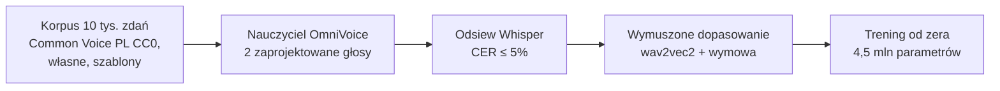

# słyszę głosy

[Demo](https://slyszeglosy-demo.damaon.workers.dev) · [Wagi](https://huggingface.co/Damaon/slyszeglosy) · [Inspiracja: tiny-voca](https://github.com/n4ze3m/tiny-voca)

Mały polski model syntezy mowy (TTS): dwa głosy, ok. 4,5 mln parametrów,
działa na CPU i w przeglądarce. To polska wersja
[tiny-voca](https://github.com/n4ze3m/tiny-voca) (Apache-2.0): ta sama
architektura i ten sam przepis treningu, z nowym front-endem fonetycznym,
nowymi danymi i nowymi głosami.

- **Mały**: 4 533 451 parametrów, plik ONNX 21 MB, z generatorem fali (bez osobnego wokodera).
- **Dwa głosy**: `F` (kobiecy) i `M` (męski), syntetyczne, 24 kHz.
- **Polski front-end** `wymowa`: reguły wymowy, akcent, liczby, daty, godziny, kwoty i skróty.
- **Działa wszędzie**: PyTorch, ONNX Runtime, ONNX Runtime Web (demo w `web/`).
- **Licencja**: kod Apache-2.0; wagi i dane **CC-BY-NC 4.0** (tylko użytek niekomercyjny).

## Wyniki

Zrozumiałość mierzona Whisperem large-v3-turbo (CER, błąd znakowy):

| Zdania | Model | Nauczyciel (OmniVoice) |
|---|---:|---:|
| Test, 50 nagrań | 0,48% | 0,52% |
| Walidacja, 50 nagrań | 0,37% | 0,28% |
| Nowe zdania z liczbami i skrótami, 20 nagrań | 0,0% | |

Trening: 104 tys. kroków, 8,9 h na jednej karcie GPU (24 GB). Synteza na CPU: ok. 150×
szybciej niż czas rzeczywisty (4 wątki), w przeglądarce ok. 25×. Karta
modelu: [docs/model-card/README.md](docs/model-card/README.md).

## Użycie

```bash
pip install -e .
hf download Damaon/slyszeglosy --local-dir weights
python -m tiny_voca.infer --checkpoint weights/slyszeglosy.pt --voice F \
  --text "Dzień dobry! Spotkanie zaczyna się o 15:30." --output dzien-dobry.wav
```

| Opcja | Domyślnie | Znaczenie |
|---|---|---|
| `--text-file` | | Tekst z pliku zamiast `--text` |
| `--voice` | `F` | `F` albo `M` |
| `--speed` | 1.0 | Tempo mowy |
| `--pitch-shift` | 0 | Wyżej albo niżej |
| `--pitch-range` | 1.0 | Mniej albo więcej melodii |

Wagi są na Hugging Face, jak w tiny-voca:
[Damaon/slyszeglosy](https://huggingface.co/Damaon/slyszeglosy) (PyTorch 18 MB,
ONNX 21 MB, karta modelu i próbki). W repozytorium git ich nie ma
(`weights/` jest w `.gitignore`).

Dłuższy tekst jest czytany zdanie po zdaniu. Liczby, daty (`12.03.2026 r.`),
godziny (`o 15:30`), kwoty (`24,50 zł`), procenty, jednostki, popularne
skróty (`np.`, `prof.`, `ul.`) i skrótowce (`NFZ`, `PKP`) są rozwijane przez
`wymowa.normalize`.

Sam front-end, bez modelu:

```python
import wymowa
wymowa.transcribe("Chrząszcz brzmi w trzcinie.")   # 'xʂˈɔ̃ʐdʐ bʐmˈi ftʂtɕˈiɲɛ .'
```

Demo w przeglądarce (ONNX Runtime Web i Pyodide, nic nie wychodzi z
urządzenia), z pobranego `weights/onnx/model.onnx` albo z własnego eksportu
(`python -m tiny_voca.export --checkpoint ... --output model.onnx`):

```bash
bash web/build_assets.sh weights/onnx/model.onnx
python -m http.server 8766 --directory web/public
```

Demo działa pod adresem https://slyszeglosy-demo.damaon.workers.dev (Cloudflare
Workers, same pliki statyczne). Wdrożenie po zbudowaniu zasobów:
`cd web && npx wrangler deploy`.

## Jak powstał



1. **Korpus** (`scripts/build_corpus_pl.py`, `corpus/`): ok. 10 tys. zdań z
   Common Voice PL (CC0), zdań napisanych dla projektu i szablonów z liczbami,
   datami i kwotami.
2. **Nagrania** (`scripts/generate_audio_pl.py`): OmniVoice klonuje dwa głosy
   zaprojektowane z samego opisu, bez nagrania prawdziwej osoby (`voices/`).
3. **Odsiew** (`scripts/screen_audio_pl.py`): Whisper large-v3-turbo; nagrania
   z CER > 5% są generowane drugi raz z innym ziarnem, potem odrzucane.
4. **Adnotacja** (`tiny_voca.prepare`, `tiny_voca.annotate`): długości głosek
   z wymuszonego dopasowania `facebook/wav2vec2-lv-60-espeak-cv-ft`. Mapę
   etykiet i przesunięcie początku głoski skalibrowano na polskich nagraniach
   (`scripts/calibrate_aligner_labels.py`, `scripts/calibrate_aligner_timing.py`).
5. **Trening** (`tiny_voca.train`): przepis tiny-voca, 104 tys. kroków,
   na jednej karcie GPU, z termostatem GPU (`--max-temp`).

Środowisko (Linux z GPU): `bash scripts/setup_env.sh`, a dla nauczyciela
`bash scripts/bakeoff/setup.sh`.

## Testy

```bash
PYTHONPATH=src:tests python -m unittest discover -s tests
```

## Ograniczenia

- Tylko polski. Dwa stałe głosy, bez klonowania. Głos można przestroić w
  stronę innego bez treningu, przez edycję wag: [docs/zmiana-glosu.md](docs/zmiana-glosu.md).
- Liczebniki po przyimkach nie są odmieniane („z 5 osobami”).
- Obce nazwy i nietypowa pisownia bywają czytane źle; poprawki trafiają do
  `src/wymowa/lexicon.py`.
- Model nie jest lepszy od swojego nauczyciela: dziedziczy jego wymowę.

## Inspiracja: tiny-voca

Projekt powstał z inspiracji [tiny-voca](https://github.com/n4ze3m/tiny-voca)
Muhammeda Nazeema: małym angielskim TTS-em, który pokazał, że 4,5 mln
parametrów i syntetyczne dane od dużego nauczyciela wystarczą na czysty,
zrozumiały głos działający w przeglądarce. Kod tiny-voca (Apache-2.0, commit w
pliku [UPSTREAM](UPSTREAM)) jest bazą tego repozytorium.

| Z tiny-voca, bez zmian | Nowe w słyszę głosy |
|---|---|
| Architektura modelu i generator fali źródło-filtr | Front-end `wymowa`: polskie reguły wymowy, akcent, normalizacja tekstu |
| Przepis treningu (straty, GAN, harmonogram) | Słownik 39 polskich głosek |
| Wymuszone dopasowanie wav2vec2 i kontrola jakości | Mapa etykiet alignera i progi jakości skalibrowane na polskim |
| Eksport ONNX i szkielet demo w przeglądarce | Korpus, nauczyciel OmniVoice, dwa nowe głosy, polska ocena, termostat GPU |

Oryginalna dokumentacja architektury: [docs/tiny-voca/](docs/tiny-voca/).
Wykaz zmian: [NOTICE](NOTICE). Cytowanie: [CITATION.cff](CITATION.cff), które
wskazuje też tiny-voca.

## Licencja i podziękowania

Kod: Apache-2.0 (na bazie tiny-voca, Muhammed Nazeem). Wagi V1, nagrania i głosy:
CC-BY-NC 4.0, bo wygenerował je OmniVoice (k2-fsa), którego wagi są
CC-BY-NC. Wagi V2 (głos `MC` z MC Speech): CC0 1.0, czyli domena publiczna,
także do użytku komercyjnego; szczegóły w
[docs/model-card-v2/README.md](docs/model-card-v2/README.md). Teksty: Mozilla Common Voice (CC0) i własne. Aligner:
`facebook/wav2vec2-lv-60-espeak-cv-ft` (Apache-2.0, tylko do adnotacji). Ocena:
Whisper (MIT).
